# Master Development Plan — 4–6 Hour Hackathon Sprint

## Strategic Priority
In [docs/RUBRIC.md](../docs/RUBRIC.md), **40/100 base points** depend on **10 confirmed real applications (30 pts)** and **10 approved real outreach messages (10 pts)**, plus up to **+100 bonus points** for real human replies, referrals, and interviews.

Therefore, **both teammates must ship a working real-submission & real-outreach path by Hour 2:15**, leaving Hours 2:15–5:30 to layer in all **5 differentiators**, execute real applications/outreach in parallel, and verify Computer B portability.

---

## Timeline & Parallel Tracks

```mermaid
gantt
    title Hackathon 4 Parallel Execution Plan (4-6 Hours)
    dateFormat HH:mm
    axisFormat %H:%M

    section Shared Setup
    S-01 Freeze Contracts, Env & Keys          :done, s1, 00:00, 30m

    section Owner A (Pipeline & Apply)
    A-01 ModelAdapter + ResumeFileAdapter      :a1, 00:30, 50m
    A-02 JobDiscovery + D1 Pre-Flight Shield   :a2, 01:20, 45m
    A-03 D3 Co-Pilot Packet & Receipts         :a3, 02:05, 50m
    A-04 D2 Anti-Slop Tailor + ATS Preview     :a4, 02:55, 55m
    A-05 D5 Gap-to-Proof + Callback Snapshot   :a5, 03:50, 40m
    A-06 Optional Headed Playwright HITL       :a6, 04:30, 35m

    section Owner B (Outreach, Inbox & QA)
    B-01 Gmail/Outlook OutreachAdapter         :b1, 00:30, 60m
    B-02 InboxAdapter + Reply Classifier       :b2, 01:30, 45m
    B-03 D4 Artifact-First Contact Research    :b3, 02:15, 60m
    B-04 Cooldown/Opt-Out + Callback UI        :b4, 03:15, 45m
    B-05 Upgrade Skills & Prompts + Sync       :b5, 04:00, 35m
    B-06 Live Submissions + Computer B QA      :b6, 04:35, 55m
```

---

## Phase Gates & Exit Criteria

### Phase 0 — Environment & Contract Freeze (0:00–0:30)
- Both teammates copy `.env.example` → `.env` (gitignored) and `config.example.json` → `config.local.json` (gitignored), verify at least one LLM key + Gmail OAuth client, and inspect `comms/BOARD.md`.
- Verify `python3 scripts/validate_package.py` and `python3 -m unittest discover -s tests -v`.

### Phase 1 — Core Live MVP (0:30–2:15)
- **Owner A:** `A-01` (`ModelAdapter` supporting OpenAI/Gemini/Anthropic + PDF/DOCX `ResumeFileAdapter`) and `A-02` (Greenhouse/Lever/Ashby public feed discovery + `D1` Pre-Flight foundation) + `A-03` (`D3` Co-Pilot Packet + SHA-256 Confirmation Receipt).
- **Owner B:** `B-01` (Gmail OAuth send + Outlook contract + manual LinkedIn copy flow) and `B-02` (`InboxAdapter` thread sync + reply classification).
- **Gate:** Handoff `H-02` (`ModelAdapter` live) unblocks Owner B LLM drafting; teammates can begin submitting real applications and approved emails immediately after Hour 2:15 so recruiter replies have time to arrive before judging.

### Phase 2 — All 5 Differentiators & Live Execution (2:15–4:30)
- **Owner A:** Complete `D1` Scam/Liveness/Friction-ROI UI badges (`A-02`), `D2` Anti-Slop linter + ATS plain-text preview (`A-04`), `D5` Gap-to-Proof micro-project tracker + `CallbackPacket` generator (`A-05`), and optional headed Playwright HITL autofill (`A-06`).
- **Owner B:** Complete `D4` Artifact-First public contact discovery (`B-03`), Cooldown/Opt-Out firewall + Callback Cheat Sheet trigger in inbox replies (`B-04`), and update all 6 `skills/*/SKILL.md` + `prompts/*.md` (`B-05`).
- **Live Rubric Push:** Submit **10 distinct real applications** (recording confirmation IDs/screenshots) and send **10 approved, unique outreach messages**.

### Phase 3 — Cross-Review, Computer B Portability & Demo Prep (4:30–5:30)
- Execute `.agent/workflows/04-cross-review.md` between Owner A and Owner B.
- Fill out `deliverables/TEAM_HANDOFF_TEMPLATE.md` with honest counts, setup instructions, and real-vs-manual disclosures.
- Run `.agent/workflows/05-release-handoff.md` and perform a clean-folder / second-computer test following `docs/ACCEPTANCE_TESTS.md`.
